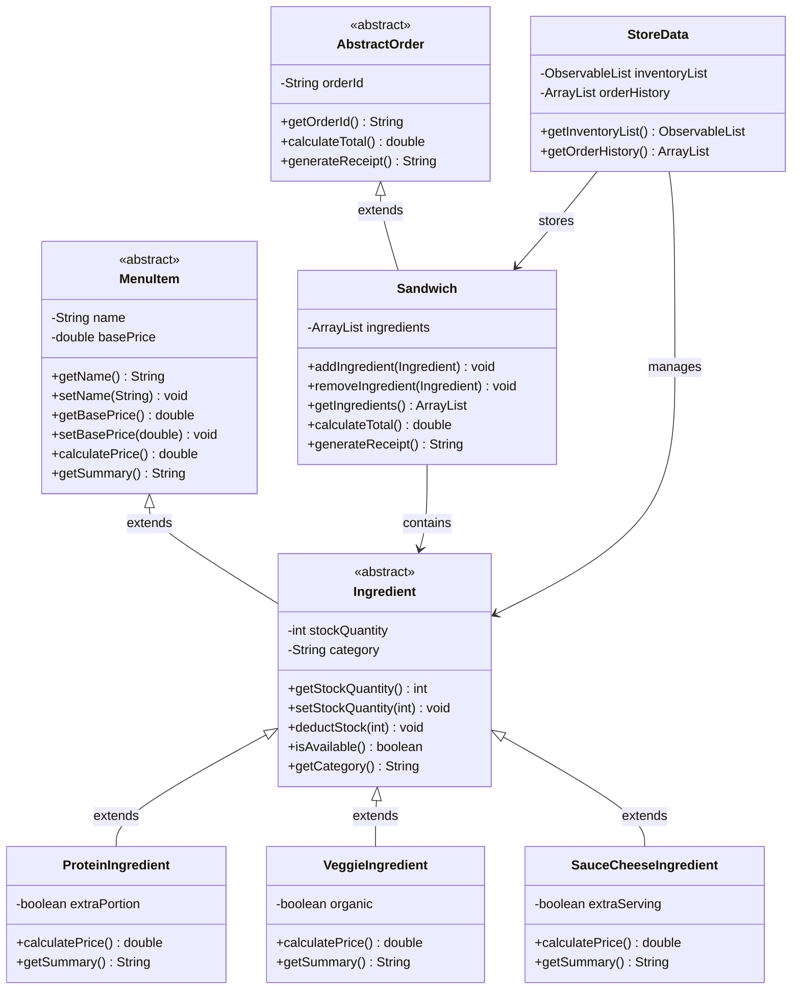

# 🥪 Sandwich Java Edition (JavaFX OOPRO System)

An interactive custom sandwich builder and inventory management system inspired by `onesandwich.com/builder/`, built with **Java (OpenJDK 25)**, **JavaFX**, **Scene Builder**, and **Maven**.

---

## 1. UML Class Diagram



---

## 2. Project Overview & OOP Architecture

This project follows the **Model-View-Controller (MVC)** architectural pattern:

- **3-Level Inheritance Hierarchy:** `MenuItem` (Level 1 Abstract Class) $\rightarrow$ `Ingredient` (Level 2 Abstract Class) $\rightarrow$ Concrete Subclasses (`ProteinIngredient`, `VeggieIngredient`, `SauceCheeseIngredient`).
- **3 Separate Abstract Classes:** `MenuItem`, `Ingredient`, and `AbstractOrder` enforce shared contracts and abstract behaviors (`calculatePrice()`, `getSummary()`, `calculateTotal()`, `generateReceipt()`).
- **Encapsulation & Validation:** Private fields with strict validation inside setters and constructors (preventing negative prices, empty names, or invalid stock counts).
- **Polymorphism:** Dynamic price calculation, stock deduction, and order receipt formatting across mixed ingredient subclasses stored inside an `ArrayList<Ingredient>` within `Sandwich`.

---

## 3. Repository Structure

```text
SandwichJavaEditionFX/
├── src/main/java/
│   ├── module-info.java              # Java module descriptors & JavaFX exports
│   ├── app/
│   │   ├── Main.java                 # Application entry point & primary stage loader
│   │   ├── WelcomeController.java    # Welcome screen navigation
│   │   ├── BuilderController.java    # Interactive sandwich customization & pricing
│   │   └── InventoryController.java  # Stock tracking & ingredient CRUD operations
│   └── model/
│       ├── MenuItem.java             # Level 1 Abstract Class
│       ├── Ingredient.java           # Level 2 Abstract Class
│       ├── ProteinIngredient.java    # Level 3 Concrete Subclass
│       ├── VeggieIngredient.java     # Level 3 Concrete Subclass
│       ├── SauceCheeseIngredient.java# Level 3 Concrete Subclass
│       ├── AbstractOrder.java        # 3rd Abstract Class (Order contract)
│       ├── Sandwich.java             # Concrete Order subclass holding ArrayList<Ingredient>
│       └── StoreData.java            # Shared inventory & order data store
├── src/main/resources/
│   ├── app/
│   │   ├── welcome-view.fxml         # Landing screen UI
│   │   ├── builder-view.fxml         # Sandwich builder UI
│   │   ├── inventory-view.fxml       # Inventory management UI
│   │   └── style.css                 # Custom JavaFX styling
│   └── images/                       # Ingredient icons & custom wallpapers
└── pom.xml                           # Maven & JavaFX dependency configuration
```
