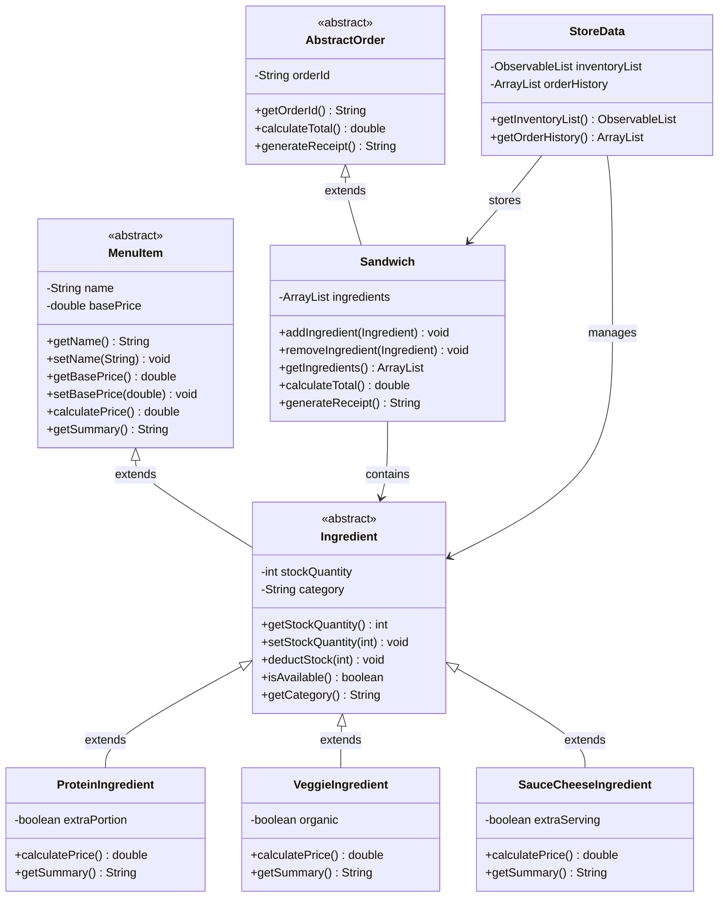

# 🥪 Sandwich Java Edition (JavaFX OOPRO System)

An interactive custom sandwich builder and inventory management system inspired by `onesandwich.com/builder/`, built with **Java (OpenJDK 25)**, **JavaFX**, **Scene Builder**, and **Maven**.

---

## 1. UML Class Diagram



---

## 2. Project Overview & OOP Architecture

This project follows the **Model-View-Controller (MVC)** architectural pattern:

- **3-Level Inheritance Hierarchy:** `MenuItem` (Level 1 Abstract Class) $\rightarrow$ `Ingredient` (Level 2 Abstract Class) $\rightarrow$ Concrete Subclasses (`ProteinIngredient`, `VeggieIngredient`, `SauceCheeseIngredient`).
- **3 Separate Abstract Classes:** `MenuItem`, `Ingredient`, and `AbstractOrder` enforce shared contracts and abstract behaviors (`calculatePrice()`, `getSummary()`, `calculateTotal()`, `generateReceipt()`).
- **Encapsulation & Validation:** Private fields with strict validation inside setters and constructors (preventing negative prices, empty names, or invalid stock counts).
- **Polymorphism:** Dynamic price calculation, stock deduction, and order receipt formatting across mixed ingredient subclasses stored inside an `ArrayList<Ingredient>` within `Sandwich`.

---

## 3. Repository Structure

```text
SandwichJavaEditionFX/
├── src/main/java/
│   ├── module-info.java              # Java module descriptors & JavaFX exports
│   ├── app/
│   │   ├── Main.java                 # Application entry point & primary stage loader
│   │   ├── WelcomeController.java    # Welcome screen navigation
│   │   ├── BuilderController.java    # Interactive sandwich customization & pricing
│   │   └── InventoryController.java  # Stock tracking & ingredient CRUD operations
│   └── model/
│       ├── MenuItem.java             # Level 1 Abstract Class
│       ├── Ingredient.java           # Level 2 Abstract Class
│       ├── ProteinIngredient.java    # Level 3 Concrete Subclass
│       ├── VeggieIngredient.java     # Level 3 Concrete Subclass
│       ├── SauceCheeseIngredient.java# Level 3 Concrete Subclass
│       ├── AbstractOrder.java        # 3rd Abstract Class (Order contract)
│       ├── Sandwich.java             # Concrete Order subclass holding ArrayList<Ingredient>
│       └── StoreData.java            # Shared inventory & order data store
├── src/main/resources/
│   ├── app/
│   │   ├── welcome-view.fxml         # Landing screen UI
│   │   ├── builder-view.fxml         # Sandwich builder UI
│   │   ├── inventory-view.fxml       # Inventory management UI
│   │   └── style.css                 # Custom JavaFX styling
│   └── images/                       # Ingredient icons & custom wallpapers
└── pom.xml                           # Maven & JavaFX dependency configuration
```

---

## 4. Contribution Table

| Member | Main Tasks | Classes / Files Worked On | Approx. % of Work |
| :--- | :--- | :--- | :--- |
| **Ray Steven Marilla** | Project setup, Maven/JavaFX config, Scene Builder UI, CSS styling, UML & Repo docs | `welcome-view.fxml`, `builder-view.fxml`, `inventory-view.fxml`, `style.css`, `module-info.java`, `pom.xml` | 25% |
| **Frances Ann Marie Dela Peña** | OOP Model hierarchy, JavaFX properties, shared data store | `MenuItem.java`, `Ingredient.java`, `ProteinIngredient.java`, `VeggieIngredient.java`, `SauceCheeseIngredient.java`, `AbstractOrder.java`, `Sandwich.java`, `StoreData.java` | 25% |
| **Neela Isabelle Hormillosa** | Application entry point, scene switching, dynamic sandwich builder logic | `Main.java`, `WelcomeController.java`, `BuilderController.java` | 25% |
| **Danielle Marie Uytiepo** | Inventory CRUD operations, TableView binding, input validation & alerts | `InventoryController.java` | 25% |

---

## 5. Individual Reflections

### Ray Steven Marilla
1. **Which OOP pillar did you work on most, and where is it in the code?**
- I'd say abstraction and inheritance. I designed the core abstract base classes (MenuItem.java, Ingredient.java, and AbstractOrder.java) and stepped in to help implement the concrete inheritance hierarchy (Sandwich.java and the Ingredient subclasses in model/) alongside separating the FXML views and CSS styling from the controller logic.
2. **What was the challenging problem you faced, and how did you solve it?**
- Integrating the UI controllers with the upgraded 3-level inheritance model—while managing JavaFX module permissions (module-info.java) and Git ownership restrictions across lab workstations—caused compilation mismatches. I resolved this by aligning method signatures (calculatePrice(), generateReceipt()), properly opening packages in module-info.java, and coordinating repository merges across the team.
3. **What is one thing you would do differently next time?**
- Finalize the UML inheritance diagram and exact method signatures before dividing tasks so that all team members' models and controllers integrate cleanly from day one without mid-project refactoring.

### Frances Ann Marie Dela Peña
1. **Which OOP pillar did you work on most, and where is it in the code?**
- I mostly worked on Inheritance and Polymorphism, particularly in the Ingredient class and its subclasses, where methods are inherited and overridden. 
2. **What was the challenging problem you faced, and how did you solve it?**
- One challenge I faced was understanding how to properly implement method overriding while giving each ingredient category its own behavior. I solved this by overriding the abstract methods in each subclass and making sure they returned the correct values based on their respective categories.
3. **What is one thing you would do differently next time?**
- Next time, I would plan and organize my classes more carefully before coding to make sure the inheritance structure and methods are properly implemented. This would help me avoid confusion and make the code easier to maintain.

### Neela Isabelle Hormillosa
- *(Fill in half-page reflection answering the 3 prompts from Section 7.2)*

### Danielle Marie Uytiepo
1. **Which OOP pillar did you work on most, and where is it in the code?**
- The OOP pillar I worked on the most was Encapsulation. This can be seen throughout the InventoryController. The different attributes of Ingredient were made private, and getter and setter methods were used frequently to access and modify them instead of directly accessing the attributes.
2. **What was the challenging problem you faced, and how did you solve it?**
- In order for our system to work the way we envisioned, I had to learn and use several methods and functions that I had not encountered before. It was challenging to understand how they worked and how to properly implement them. However, with the knowledge I gained from previous projects, the help of Google and AI, and numerous discussions with my groupmates, I was able to overcome these challenges and finish my assigned part.
3. **What is one thing you would do differently next time?**
- If I had known what we would be presenting and when the presentation would take place sooner, I think I could have prepared better and gained a deeper understanding of our system. I would have also had more time to review my work and become more confident in explaining it.


---

## 6. Change Log (Section 7.3)

- **Late Feature Added:** Refactored `Ingredient` into a multi-level abstract hierarchy (`MenuItem` → `Ingredient` → `ProteinIngredient`, `VeggieIngredient`, `SauceCheeseIngredient`) alongside `AbstractOrder` → `Sandwich`, and upgraded `builder-view.fxml` with interactive `ToggleButton` cards and live layer stacking.
- **Files Affected:** `model/*.java`, `BuilderController.java`, `builder-view.fxml`, `style.css`.
- **Bug Encountered & Fixed:** Scene Builder cached old CSS stylesheets and rejected negative `VBox` spacing; fixed by setting spacing programmatically in `BuilderController.initialize()` and reloading FXML tabs.

---

## 7. Project Timeline

| Day | Milestone |
| :--- | :--- |
| **Nov 3** | Formed our group and brainstormed for ideas. |
| **Nov 5** | Searched for references and inspirations for our program idea. |
| **Nov 10** | Division of roles and discussion of work plan |
| **Nov 12** | Work in progess |
| **Nov 17** | Finalizing documentations and checking the program |
| **Nov 19** | Finishing the documentation and checking the program |
